

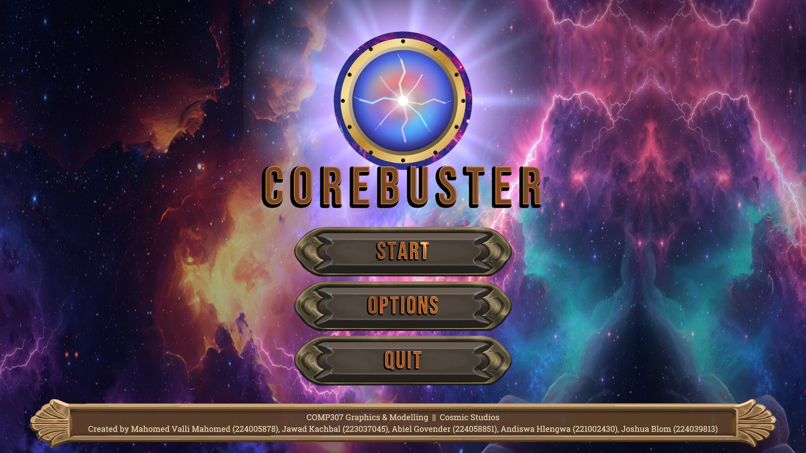

# C O R E B U S T E R

### BREAK THE ARMOUR. TAKE THE CORE. CHOOSE THE SHIP'S FATE. 

A first-person sci-fi shooter by **Cosmic Studios** · Unity 6 · University of KwaZulu-Natal · 2026

**[ABOUT](#about-this-game) · [CORE BUST](#the-core-bust) · [ARSENAL](#the-arsenal) · [ENEMIES](#hostile-units) · [THE SHIP](#the-ship) · [ENDINGS](#two-endings) · [CONTROLS](#movement-and-controls) · [TECH](#custom-shaders) · [RUN IT](#run-it) · [FORMALITIES](#project-formalities)**

 

 

<table>
<tr>
<td valign="top" width="64%">

**You wake up in a hibernation pod. The ship is not yours any more.**

Hostile robots have overrun the vessel, main power is down, and the only way out runs through five connected zones and three locked security doors.

Every armoured enemy carries a glowing **Unstable Core** in its chest. Shoot its armour off, or freeze it solid with the **Disassembler**, then step in and **tear the core out with your own gun**. The core heals you. The gas it leaves behind hurts everything that breathes it.

Take all three keycards to the Master terminal and decide how the story ends: **save yourself**, or **save everyone**.

</td>
<td valign="top" width="36%">

**GAME DETAILS**

| **Studio** | Cosmic Studios |
|:--|:--|
| **Course** | COMP307, Computer Graphics & Modelling |
| **Genre** | First-person shooter |
| **Players** | Single player |
| **Engine** | Unity 6000.5.7f1, URP |
| **Platform** | Windows |
| **Input** | Mouse and keyboard, gamepad |
| **Endings** | 2 |
| **Year** | 2026 |

</td>
</tr>
</table>

### Key features

- **The Core Bust.** A full first-person execution that heals you, and the reason every fight is worth having.
- **Armour that really breaks.** Plates are cut from the enemy's live animated pose into physical debris, with procedural cracks that glow.
- **The Disassembler.** A sidearm charged by executions. It freezes, electrocutes and opens a chest hatch on any enemy it hits.
- **Toxic core gas.** Every execution leaves a lingering, damaging cloud and a screen-edge warning that thickens the longer you stand in it.
- **Four enemy classes, nine variants.** Room-aware navigation, telegraphed attacks and enemies that react to freeze, armour and doors.
- **Keycard lockdowns.** Each major room hides a terminal that seals the doors and warps in waves until you have won the keycard.
- **Two endings.** Hold out for the escape pod, or open the vault and bust the ship's core.
- **A custom-built look.** 18 hand-written shaders, a procedural nebula sky with a lensed black hole, and optional ray-traced ambient occlusion.
- **Built from first principles.** Pipes, tanks, reactors, turbines, robotic arms, signage, ambience and the ship AI's voice are all generated by code.

---

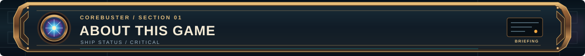

## About this game

CoreBuster is one continuous ship, played start to finish in a single level. You begin unarmed and hurt, learn the controls in a short tutorial wing, then fight outward through a workshop, a reactor room and a turbine hall to a boss hall built around the ship's core. The HUD keeps you oriented with an objective tracker, a compass that marks enemies, a Disassembler charge gauge and a core-medallion health bar.

 

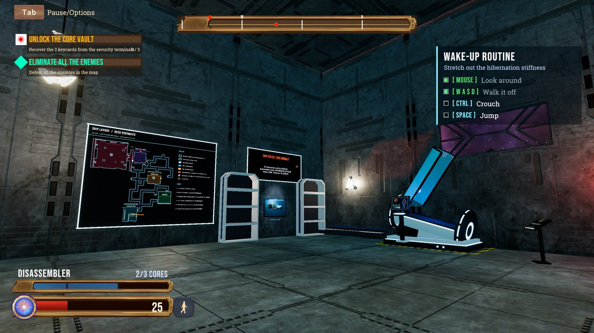

<b>▸ WAKE UP.</b> The ship AI talks you through a voiced status report while you stretch: look, walk, crouch, jump.

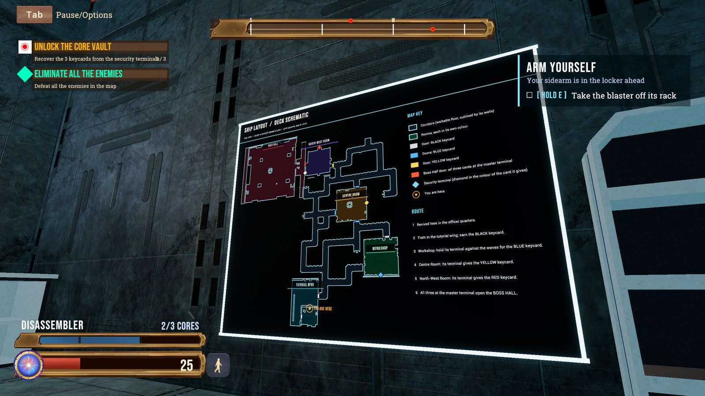

<b>▸ READ THE MAP.</b> A deck schematic on the quarters wall shows each room, its keycard door and the route to the core vault.

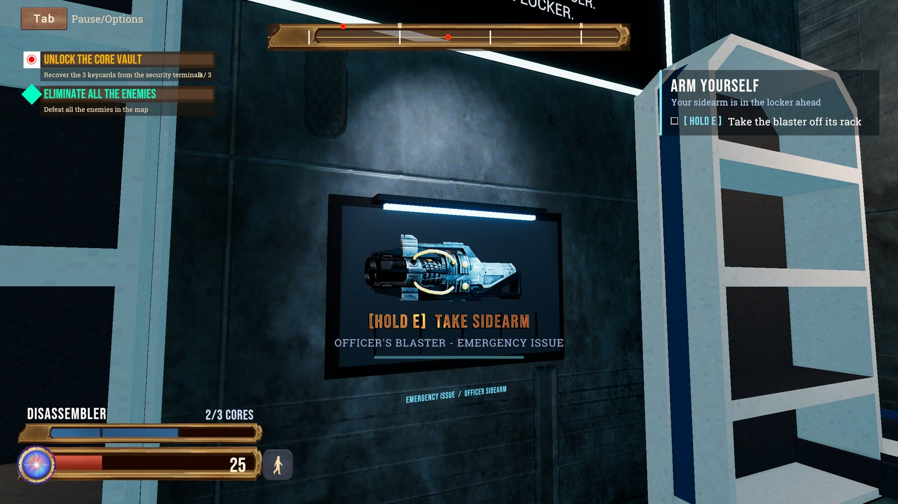

<b>▸ TAKE THE BLASTER.</b> Hold <kbd>E</kbd> at the locker. The quarters door unseals once you are armed.

**How it is built.** `TutorialDirector` advances on what the player has actually done, so out-of-order play never stalls it. The deck schematic is drawn into a texture by an editor tool (`TutorialWingShipMap`) from the real door, terminal and room data, so it cannot drift from the level. Objectives run through `ObjectiveManager` and the HUD reads them live.

---

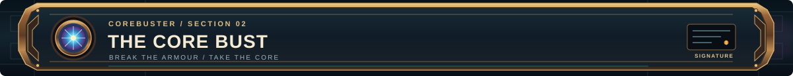

## The Core Bust

The whole game is built around one move. Three steps:

| 1 · BREAK | 2 · STEP IN | 3 · EXECUTE |
|:--:|:--:|:--:|
| Shoot an armoured enemy until its plating tears away and the **core ignites**. | Close in. A prompt appears once the core is in range and in line of sight. | **Hold <kbd>E</kbd>.** The gun jabs in, the core is sucked free, and you are healed. |

 

 

https://github.com/user-attachments/assets/0288f07b-7041-4c56-b1df-6c53fb8b8454

<b>▸ BREAK THEIR ARMOUR.</b> Plates are cut from the enemy's current animated pose, so the debris always matches what you were shooting.

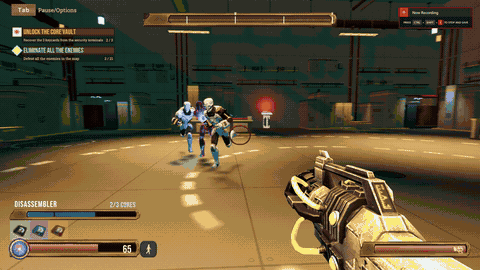

<b>▸ EXECUTE THEM.</b> The gun tucks in at the hip, jabs into the core and wrenches free. You are invincible for the whole sequence. <a href="Docs/ReadmeMedia/videos/corebust.mp4">Watch the full execution</a>

**How it is built.** A small state machine across four scripts.

| Script | Job |
|---|---|
| `ArmouredEnemy` | Soaks damage while armour holds. Below a health threshold it cuts the armour from the current skinned pose into debris chunks, swaps to the exposed material and exposes the core. |
| `CoreExecutionTarget` | Marks an enemy as executable and owns its stage (`None`, `Grabbed`, `Impaled`, `Finished`). Plays the victim's half of the animation on top of the Animator pose. |
| `CoreExecutioner` | Targeting (distance, aim angle, line of sight) and the player's half of the animation. Grants invincibility and the heal. |
| `UnstableCore` | The orb itself: a wobbling, surging sphere with embers, a light, a hum and an absorb stream. |

The order is fixed on purpose: armour break exposes a target, the target is locked out of every other execution while it is being executed, and the core is consumed before the enemy dies. These invariants are written down in [`SYSTEM_BOUNDS.md`](SYSTEM_BOUNDS.md).

### Toxic core gas

  

https://github.com/user-attachments/assets/a1f380c6-a9e1-44df-906c-b5539ceb4cc5

<b>▸ DON'T BREATHE THAT.</b> A finished execution leaves a damaging cloud. A red screen-edge warning labelled <i>TOXIC CORE GAS</i> thickens with exposure.

**How it is built.** `CoreGasCloud` is the lingering hazard, capped by `MaxActiveClouds` (default 3) so overdraw stays in check. `ToxicGasHUD` drives the screen-edge overlay (`ToxicGasOverlay` shader), and the *Galaxy Gas* particle shader draws the cloud itself.

---

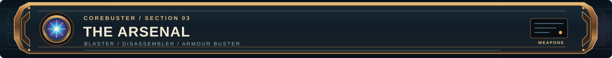

## The arsenal

<table>
<tr>
<td width="44%">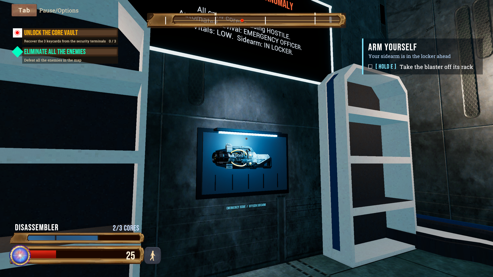</td>
<td valign="top">

### The Blaster
Your main weapon, taken from the locker in the quarters. Aim down sights, reload, and keep it ticking while you hunt for armour to break.

**Built:** `PlayerWeaponsManager`, `WeaponController`, `ProjectileStandard`. The model is a CC BY 4.0 Sketchfab asset (see [credits](#third-party-credits)).

</td>
</tr>
<tr>
<td width="44%">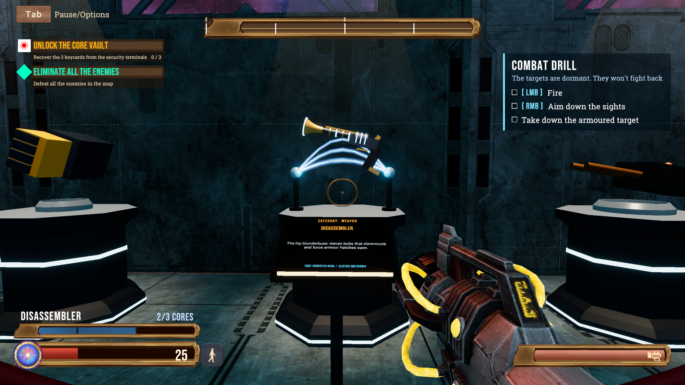</td>
<td valign="top">

### The Disassembler
Each execution charges it, and the HUD shows the charge as cores (for example *2/3 CORES*). At full charge one press of <kbd>F</kbd> quick-draws it from the left hip and fires a cluster of blue bolts. Whatever they hit is **electrocuted**: AI, weapons, navigation and animation freeze, lightning arcs to the ground, and a brass hatch irises open on its chest. Even a fully armoured enemy can then be Core Busted. If nobody finishes it, the shock wears off and it comes back for you.

**Built:** `DisassemblerBolt`, `DisassemblerShock`, `ElectrocutionVfx`, `CoreWindow` (the hatch), with the *Electric Arc* shader for the bolts and lightning.

</td>
</tr>
<tr>
<td width="44%">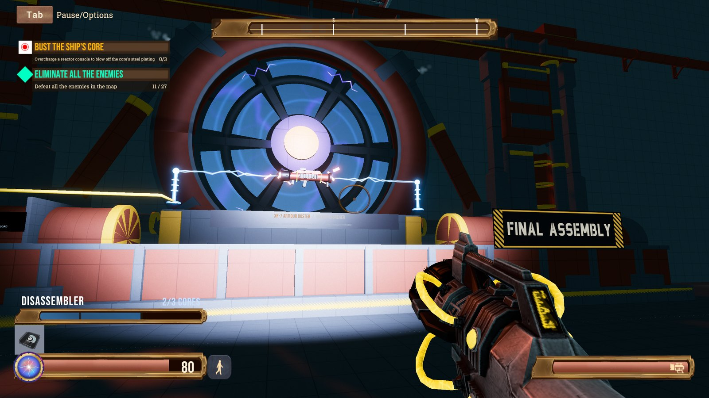</td>
<td valign="top">

### XR-7 Armour Buster
A rocket launcher held in a containment cradle by two energy beams until you **overload its power panel**. Its rockets deal no damage. The blast strips the armour from up to three nearby enemies and leaves them exposed for you to execute, so the Core Bust rules stay intact.

**Built:** `WeaponCradle` and `OverloadPanel`, with its own procedural launcher mesh.

</td>
</tr>
</table>

 

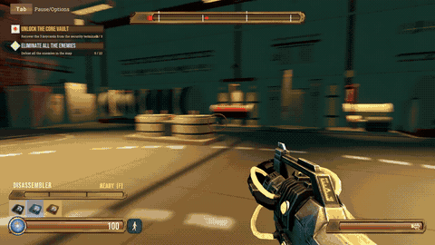

<b>▸ FREEZE THEM. OPEN THEM UP.</b> A Disassembler hit freezes the target solid and opens its chest. <a href="Docs/ReadmeMedia/videos/disassembler.mp4">Watch the full clip</a>

**Weapons you will be shot with.** The piston fist, the rivet cannon, the scrap scattergun and the Elite's rivet-burst rifle are all built from primitives in code and shown on plinths in the [fabrication gallery](#first-principles).

---

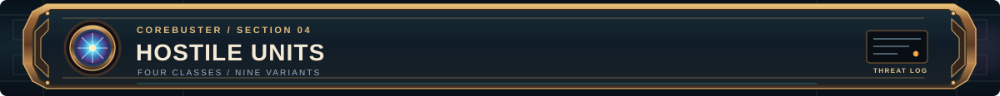

## Hostile units

Four enemy classes, nine variants. The two **armoured** classes carry a core and can be Core Busted. The other two are plain machines you shoot down.

<table>
<tr>
<td width="44%">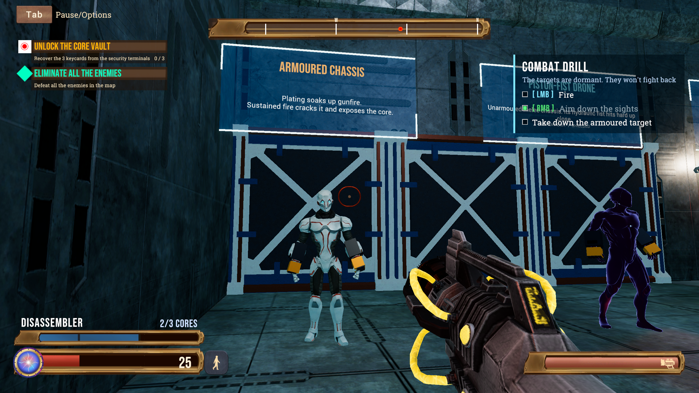</td>
<td valign="top">

### Cyber Soldier
**Armoured · carries a core.** Comes with a **piston fist** or a **rivet cannon**. Break the plating, then execute.

</td>
</tr>
<tr>
<td width="44%">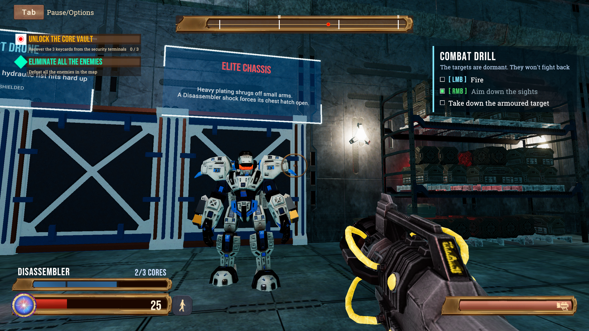</td>
<td valign="top">

### Elite
**Armoured · carries a core.** The warrior class. Comes with a **piston fist** or as a **rifleman** with a rivet-burst assault rifle. They warp in as the last wave of the North-West Room terminal and during the escape lockdown.

</td>
</tr>
<tr>
<td width="44%">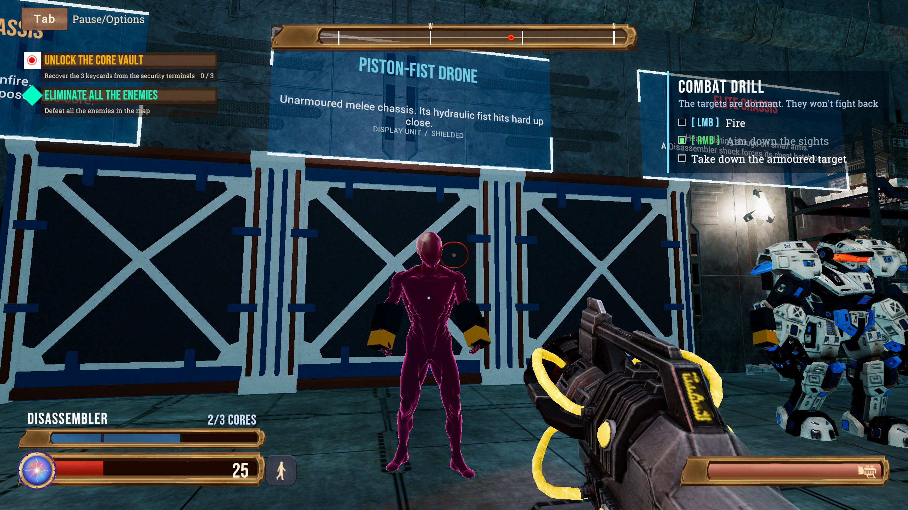</td>
<td valign="top">

### Robot1
**Brawler · no armour, no core.** A plain machine you shoot down. Comes with a **piston fist** or a **rivet cannon**. Uses the same room-aware chase brain as the armoured classes.

</td>
</tr>
<tr>
<td width="44%">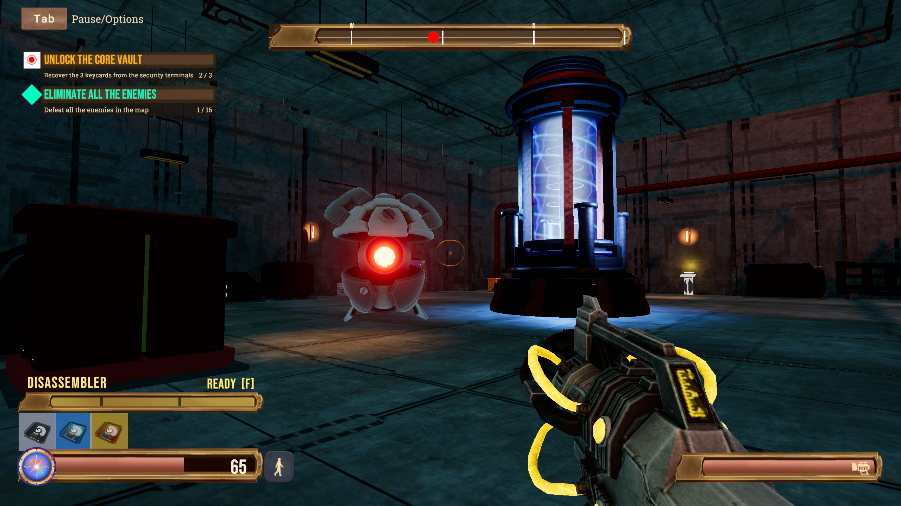</td>
<td valign="top">

### HoverBot
**Airborne · no armour, no core.** A hovering drone. Comes as a plain **HoverBot**, with a **piston fist**, or with the **scrap scattergun**.

</td>
</tr>
</table>

**How enemies behave**

| Behaviour | How it works |
|---|---|
| **Room-aware chasing** | `Robot1ChaseController` splits the NavMesh into rooms at the doors. An enemy with no complete path to you holds its room instead of pressing against a doorway. |
| **Perception** | `DetectionModule` finds the closest visible hostile actor and checks for obstructions. |
| **Telegraphed attacks** | `PistonFist` alternates arms and locks onto your position at wind-up. `RivetCannon` tracks you, flashes a warning lamp, and only fires once the arm is raised and aimed. |
| **Procedural animation** | `Robot1ProceduralAnimator` layers hook punches and raised-arm poses over the locomotion clips, scaled to world speed. |
| **Reactions** | Freeze and thaw from the Disassembler, armour state, and your position relative to doors and rooms. |
| **Warp-in** | Reinforcements arrive through a warp-in effect (`VFX_EnemyWarpIn`) rather than popping into existence. |

---

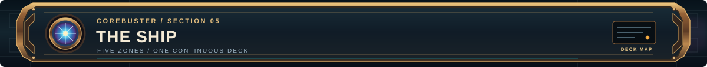

## The ship

Five zones joined by corridors, all part of one scene. Progress is gated by coloured keycards.

**The keycard loop**

| # | Zone | What you do | You get |
|:-:|---|---|---|
| 1 | **Tutorial Wing** | Wake up, take the blaster, pass the combat drill | **Black** keycard (opens the exit and the Workshop door) |
| 2 | **Start Workshop** | Access its terminal and survive **two waves** | **Blue** keycard |
| 3 | **Centre Room** | Access its terminal and survive **two waves** | **Yellow** keycard |
| 4 | **North-West Room** | Access its terminal and survive **two waves** | **Red** keycard |
| 5 | **North-West Room** | Insert blue, yellow and red at the **Master terminal** | The **core vault** opens, and the ending is yours to choose |

**How it is built.** `KeycardTerminal` seals the room's doors and runs scripted waves through the warp-in. When the last enemy falls, the doors open and the terminal ejects a floppy-disk keycard. `KeycardInteractor` plays the first-person moves (inspect, tap on a reader, slot into the Master terminal) with the player locked in place. Readers pause on *PROCESSING CREDENTIALS...* before opening, and that pause is used to pre-render the room behind the door.

### Tutorial Wing

  <a href="Docs/ReadmeMedia/videos/tutorial-wing.mp4">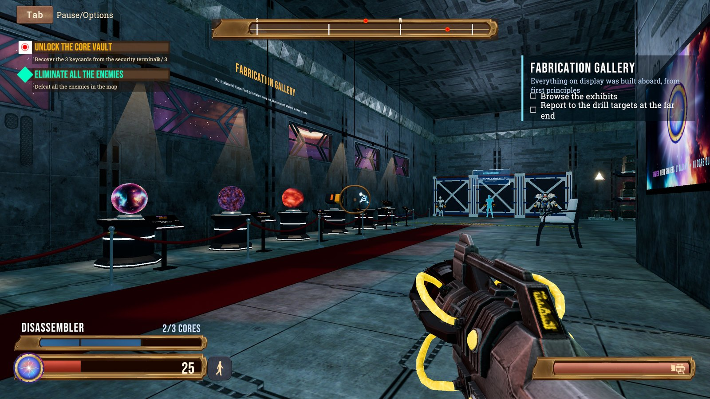</a>
  <!-- VIDEO SLOT (optional): record Docs/ReadmeMedia/videos/tutorial-wing.mp4, a slow pan from the quarters through the gallery to the drill. -->
  

<b>▸ EVERYTHING ON DISPLAY WAS BUILT ABOARD.</b> The officer quarters, a fabrication gallery of nine exhibits behind velvet ropes, and a combat drill that teaches armour, the Core Bust and the Disassembler.

### Start Workshop

  

https://github.com/user-attachments/assets/be6ee372-e7ed-4385-adf9-6c5d7ad7b168

<b>▸ THE FIRST FIGHT.</b> An industrial space dressed with code-built pipes, a tank, a robotic arm and caged lamps, with grime painted by a decal feature that only runs inside this room.

### Corridors

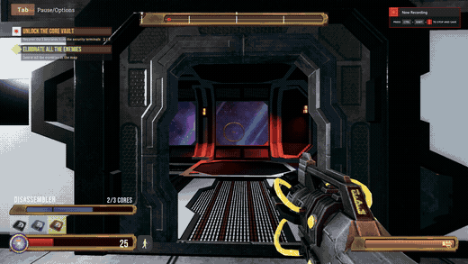

<b>▸ FOLLOW THE LIGHTS.</b> Corridors are colour-coded by route: the lamps take the colour of the keycard you need next. <a href="Docs/ReadmeMedia/videos/corridors.mp4">Watch the corridor pan</a>

<table align="center">
<tr>
<td width="50%">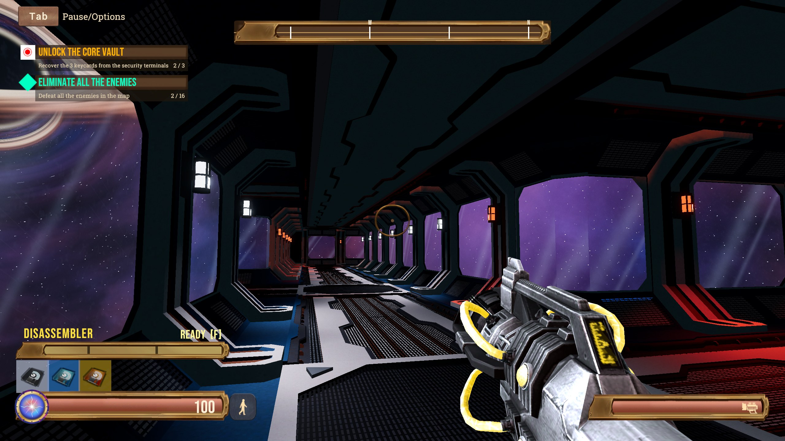</td>
<td width="50%">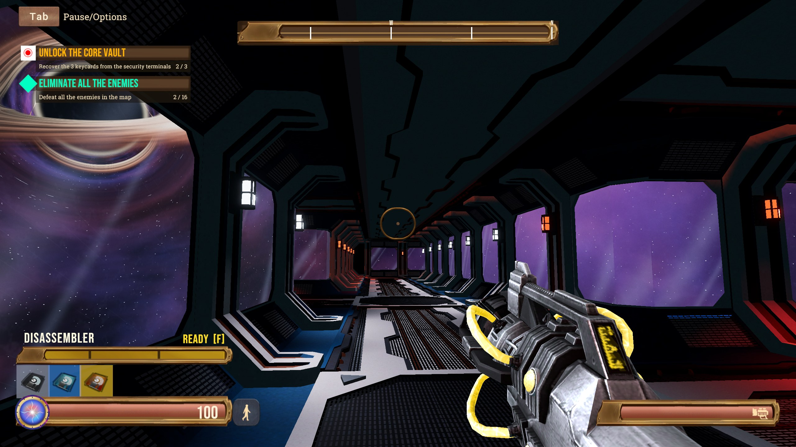</td>
</tr>
<tr>
<td align="center">▸ <b>KEEP MOVING.</b> Lamps glow with the colour of your next keycard.</td>
<td align="center">▸ <b>LOOK LEFT.</b> The black hole is a live shader, not a picture.</td>
</tr>
</table>

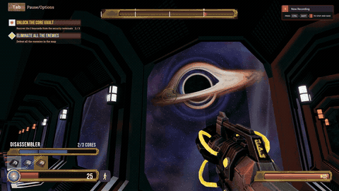

<b>▸ SPACE IS CLOSER THAN IT LOOKS.</b> Every window looks onto a live, fully procedural sky with a gravitationally lensed black hole. <a href="Docs/ReadmeMedia/videos/blackhole.mp4">Watch the clip</a>

**How it is built.** 216 caged lamps line the corridors, each with a `CorridorBeacon` that tints it to its route. The window panes use the *Sky Window* shader, which draws the same nebula as the skybox along each pixel's view ray.

### Centre Room

  

https://github.com/user-attachments/assets/f45d773b-d0c1-4a7b-aead-a677ee754fc2

<b>▸ THE REACTOR IS UNSTABLE.</b> An energy field that surges irregularly, with the room's lights mirroring every surge. Home of the yellow keycard.

### North-West Room

  

https://github.com/user-attachments/assets/8a5cdf30-de68-4c30-bb58-8960249b4a97

<b>▸ THE LAST GATE.</b> A turbine hall with the red keycard and the Master terminal beside the boss-hall door. If you choose <i>Escape</i>, this is where you hold out.

### Boss Hall

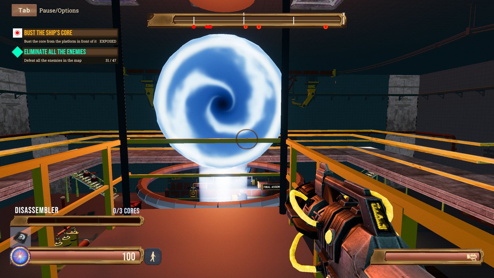

<b>▸ THE SHIP'S CORE.</b> A giant unstable core above a reactor ring, three overload consoles and a catwalk assembly, all built from code.

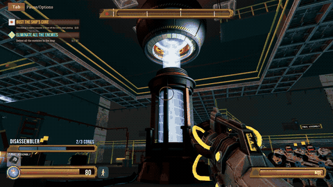

<b>▸ THEY KEEP COMING.</b> Enemies warp in around the reactor while you work. <a href="Docs/ReadmeMedia/videos/bossroom.mp4">Watch the clip</a>

---

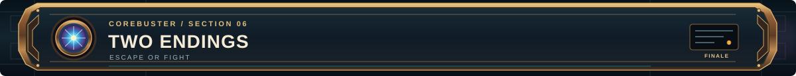

## Two endings

With all three keycards in the Master terminal, the vault opens and the game asks one question.

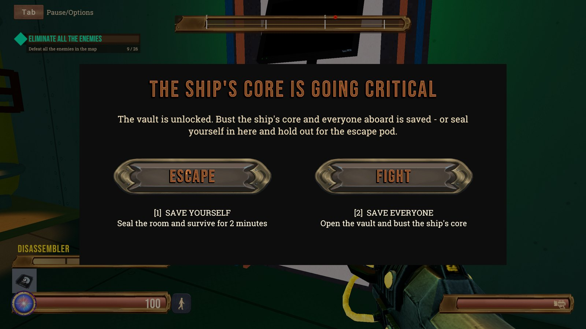

<b>▸ THE SHIP'S CORE IS GOING CRITICAL.</b> Seal yourself in and hold out for the escape pod, or open the vault and bust the core.

<table>
<tr>
<td valign="top" width="50%">

### [1] ESCAPE · *Save yourself*
The North-West Room locks down and **Elites warp in**. Survive the **two-minute countdown** and the escape pod launches, followed by a white flash and the win screen.

</td>
<td valign="top" width="50%">

### [2] FIGHT · *Save everyone*
The Boss Hall opens and enemies **warp in endlessly**. Executions charge the Disassembler, and the cores go into **three reactor consoles**. Each overload blows one armour layer (steel, ceramic, lead) off the giant core. With the heart exposed, you Core Bust it.

</td>
</tr>
</table>

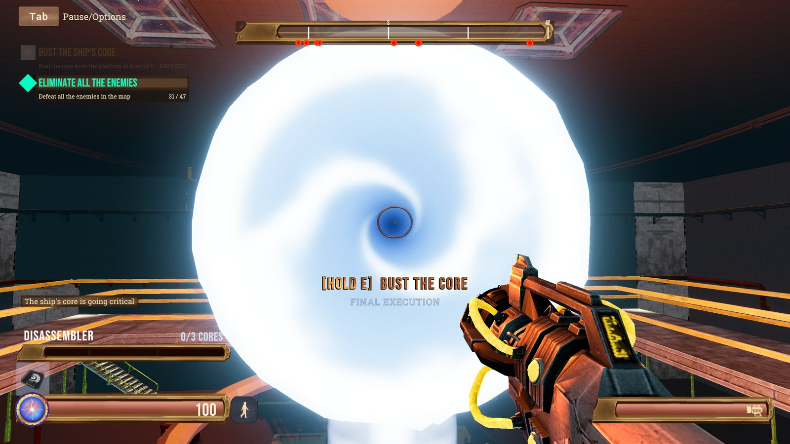

<b>▸ FINAL EXECUTION.</b> With every layer gone, the core is exposed and the prompt appears.

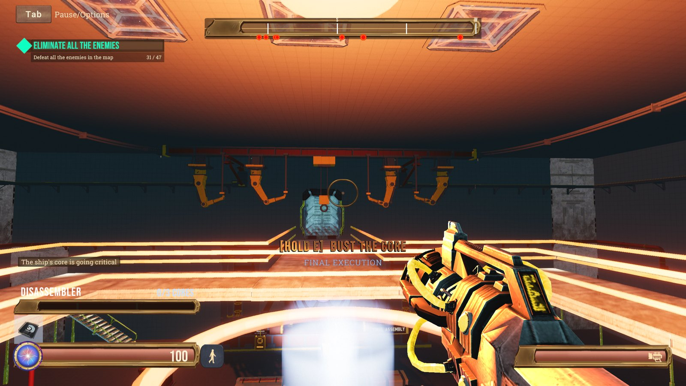

<b>▸ THE HALL BURNS.</b> The room floods with the core's meltdown glow.

**Losing.** If your health reaches zero you lose. Die during the escape lockdown and your own core expands and bursts before the lose screen.

**How it is built.** `FinaleDirector` owns both endings. Fight cores are injected through `CoreExecutioner.TryInject`, the execution played in reverse. Each overloaded `ReactorConsole` surges down its power cable, overcharges the reactor beam and removes one layer from the `GiantCore`.

---

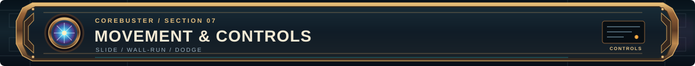

## Movement and controls

https://github.com/user-attachments/assets/ce5cf8b3-f634-4ef5-83a7-34dd98455bc0

<b>▸ STAY MOVING.</b> Slide, wall-run, wall-jump, double jump and dodge. Slides keep your momentum and wall-jumps keep the speed you ran in with, so the moves chain.

| Action | Keyboard and mouse | Gamepad |
|---|---|---|
| Move | <kbd>W</kbd> <kbd>A</kbd> <kbd>S</kbd> <kbd>D</kbd> | Left stick |
| Look | Mouse | Right stick |
| Fire | Left mouse button | Right trigger |
| Aim down sights | Right mouse button | Left trigger |
| Reload | <kbd>R</kbd> | West button |
| Jump, double jump, wall-jump | <kbd>Space</kbd> | South button |
| Sprint | <kbd>Left Shift</kbd> | Left stick click |
| **Dodge** | Double-tap <kbd>Left Shift</kbd> | |
| Crouch | <kbd>C</kbd> or <kbd>Left Ctrl</kbd> | East button |
| **Slide** | <kbd>Left Ctrl</kbd> while running (<kbd>C</kbd> also slides out of a sprint) | |
| Walk slowly | <kbd>V</kbd> | |
| Interact, take items, **Core Bust** | Hold <kbd>E</kbd> | North button |
| **Fire the Disassembler** | <kbd>F</kbd> | Left shoulder |
| Switch weapon | <kbd>1</kbd> / <kbd>2</kbd>, <kbd>Q</kbd>, or mouse wheel | D-pad |
| Pause and options | <kbd>Tab</kbd> or <kbd>P</kbd> | Start |

Keys can be rebound in the Options menu. Bindings live in `Assets/FPS/InputSystem_Actions.inputactions`.

**How it is built.** `PlayerCharacterController` extends Unity's FPS Microgame controller with a speed-boosted slide, a double-tap dodge, wall-running (needs forward input and a minimum speed, with a camera tilt) and wall-jumps that preserve forward speed.

---

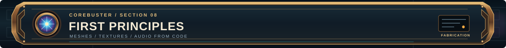

## First principles

The course asks for assets modelled from first principles. In CoreBuster that means **the code makes them**, and there is a gallery in the tutorial wing where you can walk past them.

  

https://github.com/user-attachments/assets/723f7e24-06d0-48f7-9f7a-c039d44a5238

<b>▸ BUILT FROM NOTHING BUT CODE.</b> A walk through the fabrication gallery and the procedurally generated rooms.

| Kind | What was generated | How |
|---|---|---|
| **Meshes** | Heavy Industrial Kit (pipes, elbows, tees, valves, the P-3 tank), the yellow robotic arm (7 meshes, 4,320 triangles), the Centre Room reactor, the North-West Room turbines, the caged corridor lamps, and the Boss Hall arms, catwalks and backdrop | `ProceduralMeshBuilder.cs`, a metre-scale primitive builder driven by editor tools |
| **Textures** | Signage, floor markings, grime, ambient-particle sprites and the exit board | Python and Pillow scripts in `Tools/Art/`, seeded so every run is identical. Lettering uses a hand-built stencil alphabet (`stencil_font.py`), so no font file is shipped for it |
| **Audio** | The reactor ambience loop and the ship AI's voice | The loop is synthesised in Python. The voice is Windows text-to-speech through our own DSP chain: band-pass, comb resonance, ring modulation, saturation and reverb |
| **Shaders** | The orb, armour, gas, arcs, reactor, cable, sky and more | See [custom shaders](#custom-shaders) |
| **Weapons and enemies' tools** | Rivet cannon, scrap scattergun, piston fist, XR-7 launcher | Built from primitives by dedicated editor builders |

Every generator is a menu item under `Tools/CoreBuster/` and has an authoring note in `Tools/Art/`.

---

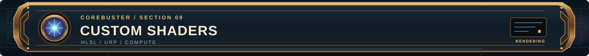

## Custom shaders

Eighteen hand-written ShaderLab/HLSL shaders for URP, plus a ray-tracing shader and a compute denoiser. None are Shader Graph. They live in `Assets/FPS/Art/Shaders/`.

<b>▸ A SPHERE THAT WILL NOT HOLD STILL.</b> The Unstable Orb: moving 3D noise displaces the surface into wobbles and spikes, driven per frame by the game.

https://github.com/user-attachments/assets/61283557-d07b-4714-9a15-dac5d15b0575

  

https://github.com/user-attachments/assets/dabfc455-9619-4511-8942-89253b1236d8

<b>▸ CRACK THE PLATING.</b> Vertex displacement dents the plates while a 3D Voronoi crack network spreads and glows.

| Shader | Technique |
|---|---|
| **Unstable Orb** | Moving 3D noise displaces the surface; surges, instability and collapse are driven by `UnstableCore.cs`. |
| **Core Window** | A brass iris hatch on a single quad. The view ray is traced in object space through a cylindrical cavity to the orb, giving real **parallax depth** with no geometry behind the quad. |
| **Galaxy Husk** | Two nebula textures **triplanar-projected**, scrolled and cross-faded, plus a procedural twinkling star layer and a **Fresnel** colour shift. |
| **Core Armour** | One shader, three styles (steel, ceramic, lead). Vertex displacement crumples plates and a 3D **Voronoi** crack network spreads and glows. `ArmourPiece` feeds per-plate damage through a `MaterialPropertyBlock`. |
| **Galaxy Gas** | Particle shader for the toxic cloud. Drifting noise shapes each puff, stars twinkle inside, and premultiplied colour lets smoke alpha-blend while hot folds add light. |
| **Electric Arc** | Additive bolts and lightning: a wandering white-hot core, glow, travelling pulses and a strobe. |
| **Reactor Containment / Core Energy Additive** | GPU-animated reactor field with irregular surges that the room lights mirror. |
| **Reactor Beam** | Domain-warped value-noise filaments, climbing pulses, flicker and an overcharge parameter driven by console overloads. |
| **Power Cable** | Lit PBR sheath with steel rib collars, idle flow dashes, and a bright energy slug that travels down the cable on an overload. |
| **Floor Guide** | Additive chevrons with soft edges and pulses travelling toward the objective. |
| **Procedural Nebula Skybox** | A fully GPU-generated nebula, no textures, so it never blurs. It also draws a **black hole**: rays inside a capture radius fall in, nearby rays are **gravitationally lensed**, and the accretion disk shows Keplerian shear, **Doppler beaming** and orbiting hot spots. |
| **Sky Window** | Corridor panes draw that same sky along each pixel's view ray, with haze, glare streaks and dust. |
| **UI Galaxy / UI Core Glow / UI Core Meltdown / Toxic Gas Overlay / Core Halo** | Menu and HUD effects, the screen-edge gas warning, and a camera-facing halo billboarded in view space. |
| **Ray-traced AO** | Two cosine-distributed rays per pixel against the level BVH, reprojected and accumulated over frames, upsampled with a depth-aware filter and handed to URP as the occlusion texture. |

---

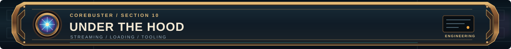

## Under the hood

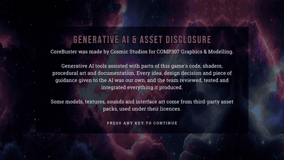

<b>▸ COSMIC STUDIOS PRESENTS.</b> The boot sequence opens with the AI and asset disclosure, then a galaxy collapses into a wormhole before the title.

**Code layout.** Gameplay code is in `Assets/FPS/Scripts/`, split into assemblies: `fps.Game` (shared primitives), `fps.Gameplay`, `fps.AI`, `fps.UI` and `fps.Rendering`.

**Room-by-room rendering.** `ZoneStreamer` splits the level into zones and draws only the zone the camera is in, plus any zone visible through an open door. Hidden renderers use `forceRenderingOff`, so colliders and AI keep running, and plain lights in hidden zones switch off.

| Measured in the Editor on an integrated GPU (Ryzen 7 5700G) | Streaming off | Streaming on |
|---|--:|--:|
| Frame time | 20.0 ms | **12.3 ms** |
| Triangles | 1.59 M | **0.51 M** |
| SetPass calls | 1,108 | **411** |

**Loading.** A `LoadingScreen` with a `LoadingGate` holds the scene until every zone is warmed and, on Ultra, the ray-tracing BVH is built. The first load takes 15 to 20 seconds in the Editor.

**Quality levels.** *Options* offers **Normal** (default) and **Ultra**. Ultra raises shadow quality and MSAA and switches on ray-traced ambient occlusion.

**Lighting.** Per-room lighting is bounded so one room's lights never affect another. The pipeline gives each object four additional lights, so rooms use a few strong lights rather than many weak ones.

**Tooling.** Rooms, props, the corridor lockdown, the keycard progression, the tutorial wing, the finale and the rocket launcher are all produced by editor builders under `Tools/CoreBuster/`, which can be re-run to rebuild their content. Survey evidence for each room is in `Docs/`.

---

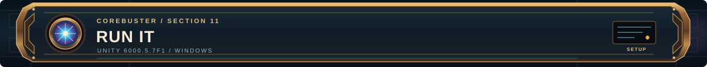

## Run it

| **Unity** | **6000.5.7f1**, pinned in `ProjectSettings/ProjectVersion.txt`. Install it through Unity Hub. |
|:--|:--|
| **OS** | Windows |
| **Graphics** | A DirectX 11 or 12 GPU. DXR hardware is optional and only used by Ultra. |
| **Python** | Python 3 with Pillow (and NumPy for one script), only to regenerate procedural textures and audio in `Tools/Art/`. Not needed to play. |

1. Clone the repository.
2. In Unity Hub choose **Add project from disk** and select the repository root, the folder containing `Assets/`, `Packages/` and `ProjectSettings/`. Open it with 6000.5.7f1. The first import takes a while because the project is large.
3. Open `Assets/FPS/Scenes/BootScreen.unity` and press **Play**. The flow is `BootScreen` → `IntroMenu` → `MainScene` → `WinScene` or `LoseScene`.

> **Note.** We ran and tested the game in the Unity Editor. A standalone player build has not been tested. The compute ambient-occlusion path is slow on integrated GPUs, so use **Normal** there.

---

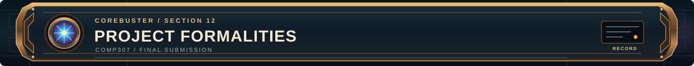

## Project formalities

| **Project** | CoreBuster |
|:--|:--|
| **Studio** | Cosmic Studios |
| **Course** | COMP307, Graphics & Modelling |
| **Institution** | University of KwaZulu-Natal |
| **Submission** | Final group submission, 2026 |
| **Engine** | Unity 6000.5.7f1 · Universal Render Pipeline 17.5 |

### Group members

| Name | Student number |
|:--|--:|
| Jawad Kachbal | 223037045 |
| Joshua Blom | 224039813 |
| Mahomed Valli Mahomed | 224005878 |
| Andiswa Hlengwa | 221002430 |
| Abiel Govender | 224058851 |

---

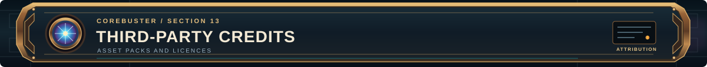

## Third-party credits

Third-party packs live in their own folders under `Assets/` and are not edited. Where the game needed a different look, project-owned copies of the materials were made under `Assets/FPS/Art/`.

| Asset | Author / publisher | Used for |
|---|---|---|
| **FPS Microgame** (`Assets/FPS`) | Unity Technologies | Base player controller, weapon, health and enemy frameworks, HoverBot, HUD and audio that the team extended |
| **SciFi Warehouse Kit** | Sickhead Games | Walls, floors, door frames, vents and the corridor kit |
| **Sci-Fi Styled Modular Pack** | Karboosx (**to verify**) | Modular floors, walls and palettes |
| **Sci-Fi Warrior PBR HP Polyart** | Polyart / Dungeon Mason (**to verify**) | Elite warrior enemies |
| **Human Basic Motions (FREE)** | Kevin Iglesias | Humanoid animation clips |
| **Steampunk UI** | Gentleland (Jacky Martin) | UI art and fonts (Bebas Neue, Roboto Slab, Arvo, each under its own licence in the pack) |
| **Sci Fi Doors and Sci fi Access Machine** | MASH Virtual | Security doors and keycard access machines |
| **3D Scifi Kit Starter Kit HD** | Creepy Cat | Sci-fi environment props |
| **Horror Puzzle Items** | | Floppy-disk keycards and small puzzle props |
| **LP Sci-Fi Weapons Lite** | JustCreate3D (**to verify**) | Low-poly weapon models |
| **Lunar Landscape 3D** |  | Rock prefabs |
| **"energy gun prototype (project c0r3)"** | average c-pen enjoyer, on [Sketchfab](https://sketchfab.com/3d-models/energy-gun-prototype-project-c0r3-60699e40cdc94060aa219e7b4e0bfa80), licensed [CC BY 4.0](https://creativecommons.org/licenses/by/4.0/) | Main weapon model (`Assets/Models/Main Weapon`) |
| **Cyber Soldier model and textures** (`Assets/MyAssets/CyberSoldier`) |  | Armoured Cyber Soldier enemies |
| **Robot1** (`Assets/Models/Robot1.fbx`) | | Robot1 enemies |
| **Nebula images** (`Assets/Custom Textures`) | | Nebula and skybox textures |
| **TextMesh Pro, ProBuilder, Cinemachine, Input System, URP, AI Navigation, NavMeshComponents** | Unity Technologies | Engine packages |
| **Roboto, LiberationSans, EmojiOne** | See `Assets/FPS/Third-PartyNotice.txt` | Fonts bundled with FPS Microgame |
| **Windows text-to-speech** (Microsoft Zira) | Microsoft | The ship AI's raw voice, before our DSP processing |

Required Sketchfab attribution: this work is based on "energy gun prototype (project c0r3)" by average c-pen enjoyer, licensed under CC BY 4.0.

---

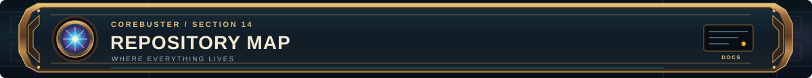

## Repository map

| Path | Contents |
|---|---|
| `Assets/FPS/` | Game scripts, scenes, prefabs, art, audio and shaders |
| `Assets/FPS/Art/Shaders/` | Custom shaders (`CoreBuster/` holds the project-specific ones) |
| `Assets/FPS/Scripts/` | Runtime code, with editor generators under `*/Editor/` |
| `Tools/Art/` | Python generators and authoring notes for procedural art and audio |
| `Docs/` | Room-by-room survey evidence and the final polish notes (`Docs/FinalPolish/README.md`) |
| `Docs/ReadmeMedia/` | Banners, GIFs, posters, screenshots and clips used by this README |
| `SYSTEM_BOUNDS.md` | Hard invariants for the build, assets, lighting and core execution |
| `AGENTS.md` | Contribution rules and document ownership |
| `Project_Specification.pdf`, `Project_Assessment.pdf` | The course brief and marking memo |
| `CoreBuster_Project_Overview.pdf`, `COREBUSTERS CONCEPTS.pdf`, `CoreBuster.pptx` | The original design brief, concept art and presentation |

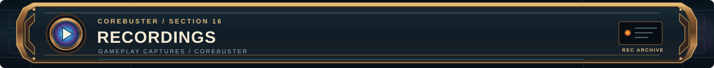

https://github.com/user-attachments/assets/9c9cb0b8-743b-46c1-bcb7-121bacd6545c

https://github.com/user-attachments/assets/55b80af4-2e25-47b1-bef4-060ed74984b5

https://github.com/user-attachments/assets/b3f7ede0-4639-46a5-9a22-25e9d3a11f1f

https://github.com/user-attachments/assets/f9d2e606-3248-4b8c-9358-6d94c04ba50e

https://github.com/user-attachments/assets/64dec654-7fd6-48fd-92c0-25de904cabb3

https://github.com/user-attachments/assets/26393740-a302-4089-88b7-6445db1c5629

https://github.com/user-attachments/assets/19b74acb-c41a-431c-a796-25b52553f9d5

https://github.com/user-attachments/assets/6aff9b19-74e1-44ce-aea9-f4de92b0599e

https://github.com/user-attachments/assets/998fcbbb-f889-4212-b287-094ffeae5282

https://github.com/user-attachments/assets/9f1f0ba3-50a8-4079-b7bd-d1e03cf60406

https://github.com/user-attachments/assets/bdf0c87b-2b7a-41b5-94c1-75572a7daf97

https://github.com/user-attachments/assets/3c8baf3b-881c-4443-8437-ba1397cf96e5

https://github.com/user-attachments/assets/42c04ee0-5a84-4852-9a23-a0f2d3a1407f

https://github.com/user-attachments/assets/d1eefe47-b6b7-4ccc-951a-b427de7f892c

https://github.com/user-attachments/assets/c65a76ee-177b-4fba-a459-270810386a03

https://github.com/user-attachments/assets/2ab1ab40-469c-4ec2-a3bd-12420b1f4273

https://github.com/user-attachments/assets/f701c3e7-47a5-43c7-9ddb-16394e583701

https://github.com/user-attachments/assets/1c954adf-5dc7-4f5d-8118-f043ce302809

https://github.com/user-attachments/assets/44f0f66b-3a91-471c-84b0-2edd80cf746a

---

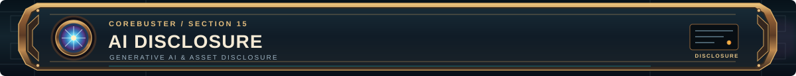

## AI disclosure

This is the disclosure the game itself shows at startup:

> **GENERATIVE AI & ASSET DISCLOSURE**
>
> CoreBuster was made by Cosmic Studios for COMP307 Graphics & Modelling.
>
> Generative AI tools assisted with parts of this game's code, shaders, procedural art and documentation. Every idea, design decision and piece of guidance given to the AI was our own, and the team reviewed, tested and integrated everything it produced.
>
> Some models, textures, sounds and interface art come from third-party asset packs, used under their licences.

---

### THE CORE IS UNSTABLE. THE CHOICE IS YOURS.

Cosmic Studios · COMP307 Graphics & Modelling · University of KwaZulu-Natal · 2026

<a href="#c-o-r-e-b-u-s-t-e-r">Back to top</a>

